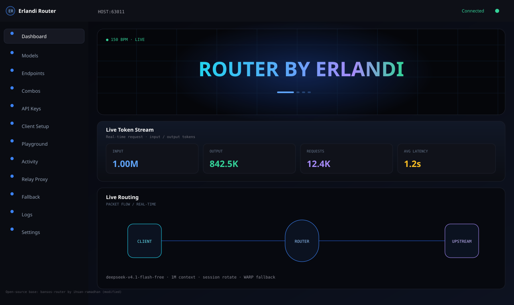

<div align="center">

# ⚡ ERLANDI ROUTER

### Satu endpoint untuk semua model. Model tetap. Limit diatasi. Panel bergerak.

[](https://github.com/erlandi-main-api/erlandi-router)
[](https://nodejs.org)
[](https://go.dev)
[](https://www.gnu.org/licenses/gpl-3.0.html)

<br>



<br>

**Panel:** `http://HOST:63011` &nbsp;·&nbsp; **API:** `http://HOST:63011/v1`

</div>

---

## Masalah yang dipecahkan

Router AI pada umumnya melakukan ini saat model kena limit:

> request DeepSeek → kena 429 → diam-diam kirim ke model lain

Itu merusak kontrol. Master minta DeepSeek, yang datang model lain.

**Erlandi Router melakukan sebaliknya:**

> request DeepSeek → kena 429 → putar session → ganti egress → **tetap DeepSeek**

Kalau Master mau fallback model, Master yang bikin **Combo** sendiri. Router tidak pernah memutuskan diam-diam.

---

## Fitur utama

### 1. Fixed model — model tidak pernah diganti diam-diam
Fallback global default **OFF**. Request `deepseek-v4.1-flash-free` selalu dijawab model itu. Kalau upstream gagal, Master dapat error asli — bukan pengganti.

### 2. Infinity Session Engine — limit diatasi, bukan dihindari
Khusus model Zen/OpenCode termasuk DeepSeek:

- session diputar tiap **16 request** atau **12 menit**
- kena `429` → session baru, retry **model yang sama**
- masih `429` → session baru + WARP egress, retry **model yang sama**
- TLS memakai fingerprint Bun-compatible lewat relay lokal

Artinya kuota habis tidak langsung bikin request gagal. Sistem cari jalur baru dulu sebelum menyerah.

### 3. Combo Chain — fallback yang Master atur sendiri
Buat alias `combo/nama` berisi urutan model. Router jalan ke model berikutnya **hanya** kalau Master yang definisikan urutannya.

Contoh: `combo/master` → DeepSeek dulu, particle cadangan.

### 4. Custom Endpoints — provider apa pun
Tambah provider OpenAI-compatible lewat menu **Endpoints**. Router auto-discover model dari `/models` dan menamainya `<provider>/<model>` supaya tidak tabrakan antar provider.

### 5. API Keys — ala router sungguhan
Buat key bebas, lihat full value, copy, hapus. Beda dari kebanyakan tool yang cuma kasih prefix. Playground tetap bisa dipakai tanpa key.

### 6. Dashboard motion — sistem kompleks, tampilan hidup
- Showreel **150 BPM**: ganti nama model tiap 400 ms, 8 gaya transisi, confetti, strobe, radar rays, marquee
- Soundtrack cinematic procedural via Web Audio API — tanpa file audio
- **Live Token Stream**: input/output token, request, latency, request terakhir, grafik batang real-time
- **Live Routing**: packet flow CLIENT → ROUTER → UPSTREAM dengan radar sweep
- Transisi halus di semua menu

---

## Tampilan panel

| Menu | Yang bisa dilakukan |
|---|---|
| **Dashboard** | Lihat showreel, token stream, dan routing live |
| **Models** | Lihat katalog, ping model, cek health |
| **Endpoints** | Tambah/hapus provider OpenAI-compatible |
| **Combos** | Susun rantai model dan prioritasnya |
| **API Keys** | Buat, copy, hapus key |
| **Client Setup** | Generate konfigurasi harness |
| **Playground** | Test chat tanpa perlu key |
| **Activity** | Lihat usage dan animasi routing |
| **Relay Proxy** | Kelola node relay / Cloudflare Worker |
| **Fallback System** | Nyalakan/matikan fallback global |
| **Logs** | Pantau log daemon |
| **Settings** | Port, bind, security, backup |

---

## Arsitektur ringkas

```
Client (curl / harness / Playground)
        │
        ▼
Erlandi Router :63011
   ├── /v1/chat/completions     OpenAI Chat Completions
   ├── /v1/messages             Anthropic Messages
   ├── /v1/responses            OpenAI Responses
   ├── /bansos/*                Admin API
   │
   ├── Zen / DeepSeek ──► TLS relay :63015
   │                        ├── direct egress
   │                        ├── session rotation
   │                        └── WARP :63013 saat 429
   ├── Free models ──────► direct / Cloudflare Worker
   └── Custom endpoint ──► <provider>/<model>
```

### Port

| Port | Fungsi |
|---|---|
| `63011` | Router + dashboard |
| `63012` | WARP SOCKS5 |
| `63013` | WARP HTTP proxy |
| `63014` | WARP WireGuard listen |
| `63015` | TLS relay lokal |

---

## Tutorial instalasi

### Kebutuhan

- Node.js **≥ 22.5**
- Go (untuk build TLS relay)
- FreeBSD atau Linux

### Langkah 1 — Siapkan source

```bash
git clone <URL_REPO_PRIVATE> erlandi-router
cd erlandi-router
npm install
npm run build
npm i -g .
```

### Langkah 2 — Konfigurasi router

```bash
mkdir -p ~/.bansos
cat > ~/.bansos/config.json <<'JSON'
{
  "port": 63011,
  "bind": "0.0.0.0",
  "security": {
    "mode": "normal",
    "dlp": "redact",
    "allowedUpstreams": [],
    "allowCrossProviderFailover": false
  }
}
JSON
```

`allowCrossProviderFailover: false` adalah kunci supaya model tidak pindah sendiri.

### Langkah 3 — Jalankan router

```bash
bansos start --bg \
  --port 63011 \
  --bind 0.0.0.0 \
  --unsafe-allow-non-loopback
```

Buka panel di `http://HOST:63011`.

### Langkah 4 — Jalankan TLS relay untuk DeepSeek

```bash
cd zen-tls-relay
go build -o ~/.local/bin/zen-tls-relay .

tmux new-session -d -s zen_tls \
  "$HOME/.local/bin/zen-tls-relay 2>&1 | tee -a ~/.warp/zen-tls.log"
```

Relay mendengar di `127.0.0.1:63015`. Router otomatis memakainya untuk model Zen saat direct kena `403/429`.

Cek statistik session:

```bash
curl http://127.0.0.1:63015/stats
```

### Langkah 5 — WARP (opsional, tapi disarankan)

```bash
go install github.com/ViRb3/wgcf@v2.3.1
go install github.com/windtf/wireproxy/cmd/wireproxy@v1.1.3

mkdir -p ~/.warp && cd ~/.warp
wgcf register
wgcf generate
```

Tambahkan ke `wgcf-profile.conf`:

```ini
ListenPort = 63014

[Socks5]
BindAddress = 127.0.0.1:63012

[http]
BindAddress = 127.0.0.1:63013
```

Jalankan:

```bash
tmux new-session -d -s warp_proxy \
  "$HOME/.local/bin/wireproxy -c $HOME/.warp/wgcf-profile.conf"
```

---

## Tutorial pemakaian API

### Buat API key

Buka panel → menu **API Keys** → isi nama → **Add**. Key langsung terlihat lengkap dan bisa di-copy.

### Chat dengan model tetap

```bash
curl -sS http://HOST:63011/v1/chat/completions \
  -H 'Content-Type: application/json' \
  -H 'Authorization: Bearer API_KEY' \
  -d '{
    "model": "deepseek-v4.1-flash-free",
    "messages": [{"role": "user", "content": "Halo"}],
    "max_tokens": 1000
  }'
```

Tidak perlu header khusus. Fallback global sudah OFF, jadi model tidak akan berganti.

### Pakai combo

```bash
curl -sS http://HOST:63011/v1/chat/completions \
  -H 'Content-Type: application/json' \
  -H 'Authorization: Bearer API_KEY' \
  -d '{
    "model": "combo/master",
    "messages": [{"role": "user", "content": "Halo"}]
  }'
```

### Pakai endpoint custom

Setelah endpoint `myapi` ditambahkan di menu **Endpoints**, model dipanggil sebagai:

```text
myapi/nama-model
```

---

## Admin API

| Endpoint | Method | Fungsi |
|---|---|---|
| `/bansos/status` | GET | Status daemon |
| `/bansos/config` | GET / POST | Setting dan endpoint |
| `/bansos/api-keys` | GET / POST | CRUD API key |
| `/bansos/combos` | GET / POST | CRUD combo |
| `/bansos/relay` | GET / POST | Node relay |
| `/bansos/usage` | GET | Statistik token |
| `/bansos/events` | GET | Activity real-time |
| `/bansos/refresh` | POST | Refresh katalog model |

---

## Catatan penting

- `deepseek-v4.1-flash-free` punya context **1.000.000 token** dan max output **32.000 token**. Metadata ini dipaksa tetap 1M meski katalog upstream kadang melaporkan 200K.
- Semua animasi otomatis mati kalau sistem meminta `prefers-reduced-motion`.
- Soundtrack hanya bunyi setelah ikon speaker diklik, sesuai kebijakan autoplay browser.
- Jangan expose panel ke internet tanpa proteksi. Gunakan reverse proxy atau firewall.

---

## Atribusi

Open-source base: [bansos-router](https://github.com/ihsan-ramadhan/bansos-router) oleh [@ihsan-ramadhan](https://github.com/ihsan-ramadhan) — dimodifikasi secara ekstensif untuk Erlandi Router. Lisensi upstream GPL-3.0-only.

Satu baris atribusi yang sama juga ditampilkan permanen di footer sidebar panel.
